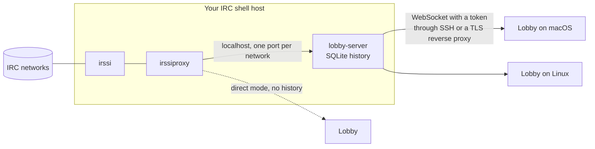
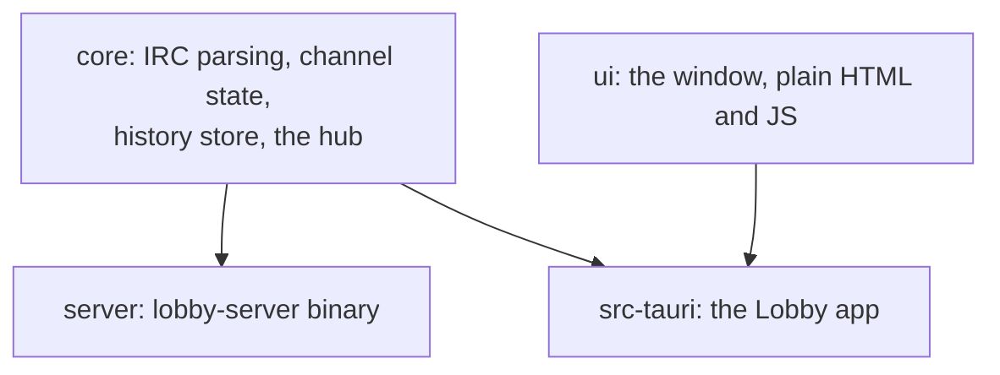

# Lobby

A small, modern IRC client for Linux and macOS. One reading column, messages grouped by person, link previews, and a window that is happy to live in the corner of your screen.

Lobby does not replace your IRC setup. It reads from what you already run, such as irssi with irssiproxy, and everything stays self-hosted.

## How it works

IRC history only exists if something stays online while you are away. If you use irssi, that is already true: irssi sits on your shell host and sees every message. What it cannot do is hand those messages to another app. irssiproxy only passes on what happens from the moment you connect.

lobby-server fills that gap. It runs next to irssi, connects to irssiproxy on the same machine like any client would, and writes every line to a small SQLite file. The Lobby app connects to lobby-server, gets the history on start and the live chat after that. irssi itself is not touched and keeps working over SSH as before.



The app can run in two ways:

| Mode | Connects to | History |
|------|-------------|---------|
| Server | lobby-server | Everything lobby-server has recorded, also from while the app was closed |
| Direct | irssiproxy or any IRC server | Only what arrived while the app was running |

### Inside the repository



- `core` keeps IRC connections running, turns lines into events and stores them. Both the app (direct mode) and lobby-server use it.
- `server` is lobby-server: the hub plus a WebSocket endpoint.
- `src-tauri` is the desktop app. In server mode it talks to lobby-server, in direct mode it runs the hub itself.
- `ui` is what you see. It does not know which mode is in use.

Built with Rust and [Tauri](https://tauri.app). The window uses the web view that comes with the system, not a bundled browser.

## Status

Early. Works: server and direct mode, history, grouped messages, link previews, channel switcher, nick completion.

Coming: profile photos and nick aliases, attachments, emoji picker, notifications, an iPhone version, and more sources next to irssiproxy (WeeChat relay, Matrix and Beeper, and a way to plug in your own).

## Installing

Lobby is built from source for now. There are no ready-made packages yet.

### 1. Build tools

Rust 1.85 or newer, from [rustup.rs](https://rustup.rs) or your package manager.

Linux also needs WebKitGTK 4.1 and a C compiler:

| System | Command |
|--------|---------|
| Arch | `sudo pacman -S --needed base-devel webkit2gtk-4.1` |
| Debian, Ubuntu | `sudo apt install build-essential libwebkit2gtk-4.1-dev` |
| Fedora | `sudo dnf install webkit2gtk4.1-devel gcc` |

macOS needs the Xcode command line tools: `xcode-select --install`.

### 2. Build and run the app

```sh
git clone https://github.com/rollecode/lobby
cd lobby
cargo build --release -p lobby
./target/release/lobby
```

To update later: `git pull`, then build again.

### 3. Point it at your chat

On first start Lobby writes a config template and shows where it is. The gear in the top right shows the path too.

- Linux: `~/.config/lobby/config.toml`
- macOS: `~/Library/Application Support/lobby/config.toml`

**Server mode**, with history. Set up lobby-server first ([instructions](server/README.md)), then:

```toml
[server]
ssh = "you@your-shell-host"
token_file = "~/.config/lobby/server.token"
```

`ssh` makes Lobby open an SSH tunnel to the server itself, using your usual SSH key. If you have put lobby-server behind a web server with TLS instead, use `url = "wss://lobby.example.org"`.

**Direct mode**, without history, straight to irssiproxy or any IRC server:

```toml
nick = "yournick"

[[network]]
name = "IRCnet"
host = "irc.example.org"
port = 6667
password_file = "~/.config/lobby/ircnet.pass"
```

Restart Lobby after changing the config.

### lobby-server

See [server/README.md](server/README.md): turning on irssi's proxy, installing, configuring, connecting the app, updating and removing.

### Troubleshooting

- **The window stays empty on Linux**: try starting it with `WEBKIT_DISABLE_DMABUF_RENDERER=1 ./target/release/lobby`. This has helped with some graphics drivers.
- **An orange line under the header**: it names the network or server that is not connected, and why.
- **Nothing shows up at all**: open the gear, check the config path, and compare the file with the examples above.

## Using it

- Click the channel name, or press `Ctrl+K`, to switch channels
- `Alt+1` to `Alt+9`: jump to a channel
- `Alt+Left` and `Alt+Right`: previous and next channel
- `Tab`: complete a nick
- `Up` in an empty input: bring back the last message

Commands work as in other clients: `/me`, `/msg`, `/join`, `/part`, `/topic`, and anything else is sent as is. `/quit` is disabled, because through irssiproxy it would disconnect irssi from the network.

## The app and lobby-server protocol

JSON over a WebSocket. The app sends `hello` with the token first, the server answers `welcome` with the current state and then streams events. Requests carry an `id` that the reply repeats. The types live in `core/src/protocol.rs`.

```
app    {"type":"hello","token":"..."}
server {"type":"welcome","snapshot":{"networks":[...],"channels":[...]}}
server {"type":"event","event":{"type":"line","net":"IRCnet","buffer":"#linux","nick":"jaska","text":"hei",...}}
app    {"type":"history","id":1,"net":"IRCnet","buffer":"#linux","before":null}
server {"type":"reply","id":1,"data":[...],"error":null}
app    {"type":"send","id":2,"net":"IRCnet","buffer":"#linux","text":"moi"}
```

## Tests

```sh
cargo test --workspace
node --test tests/lib.test.mjs
```

## Licence

MIT
