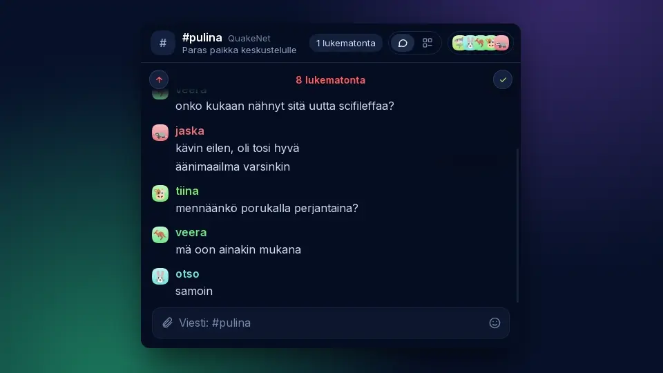

  

<h1 align="center">Pulina app for #pulina on QuakeNet</h1>

  
  
  
  
  

  The chat app for <a href="https://www.pulina.fi">#pulina</a> on QuakeNet, made for that one channel. 
  Pick a nick and you are in, on your computer or your phone. In Finnish, or in English if you like.

  

## Features

### 👋 In without setup

The welcome asks for a nick and takes you to #pulina on QuakeNet. No server, no config file, no other networks.

### 🇫🇮 Finnish first

Pulina speaks Finnish out of the box. English is one switch away in Settings.

### 💬 Grouped chat

One face and name per person, their lines stacked under it. Links become cards; pictures, videos and audio play inline.

### 😂 Reactions and replies

Sent as plain IRC, `nick: 😂` and `nick: text`, and shown as reactions and quotes, so everyone on other clients still reads them.

### 📥 Highlights

Lines that name you, from all channels, in one list. Mark them done, filter them, and jump to where each was said.

### 📣 Notifications your way

Per channel, every message or only highlights, for the app icon count and for notifications. Name people and words that always notify you.

### 🗃️ Channel shelf

The links and pictures posted in a channel, each a jump back into the conversation.

### 👑 Most active

Today's talkers by words, and yesterday's top three where a new day starts.

### ⌨️ IRC commands and keys

`/whois`, `/names` and the rest, a `/` menu, numbered channels and jump keys.

### 🔄 Updates by themselves

On Mac, Windows and the Linux AppImage, Pulina installs new versions itself, or asks first if you prefer.

### 📱 Platforms

Linux, macOS, Windows and Android. iPhone follows through TestFlight.

## Built on Lobby

Pulina is [Lobby](https://github.com/rollecode/lobby) with Pulina's name, look and language, locked to #pulina on QuakeNet. For other networks, servers and [lobby-server](https://github.com/rollecode/lobby#lobby-server), use Lobby.

Pulina's own changes live in a few files: `ui/brand.js` (name, icons, the welcome's #pulina preset, the default language), `ui/brand.css` (the pulina.fi colours), `src-tauri/icons` and the app's identity in `src-tauri/tauri.conf.json`.

Every night a workflow merges the newest Lobby into Pulina. A clean merge goes straight to `main`, and a new Lobby version releases Pulina too. When Lobby changes its own workflows or touches the same lines as Pulina, an issue asks for a merge by hand.

## Installation

Download the latest build from [Releases](https://github.com/pulinairc/pulina-app/releases/latest):

| System | File |
|--------|------|
| Debian, Ubuntu | `.deb`, install with `sudo apt install ./Pulina_*.deb` |
| Other Linux | `.AppImage`, make it executable and run it |
| macOS (Apple silicon) | `.dmg` |
| Windows | `-setup.exe` |
| Android | `.apk`, open it on the phone and allow installing from your browser |

The macOS build is not signed. After moving Pulina to Applications, run `xattr -dr com.apple.quarantine /Applications/Pulina.app` once, or macOS refuses to open it. The Windows installer is not signed either: on the SmartScreen warning, choose More info, then Run anyway.

<strong>Building from source</strong>

The same as Lobby: see [Installation](https://github.com/rollecode/lobby#installation) in Lobby's README, with this repository in place of Lobby's.

