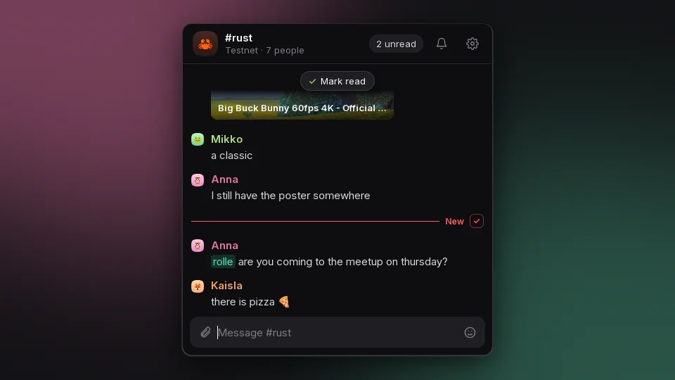
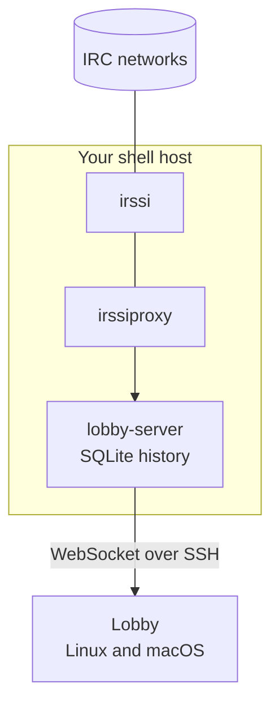
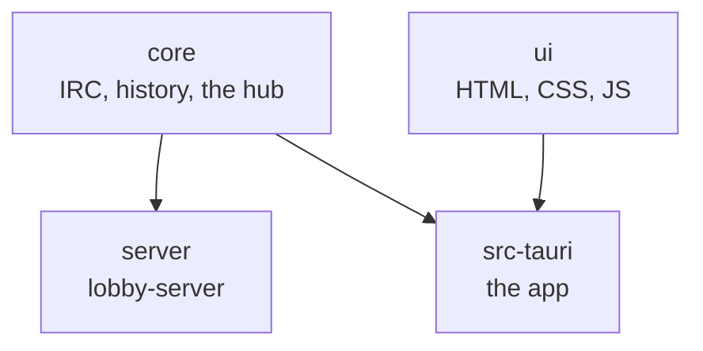

<p align="center">
  
</p>

<h1 align="center">Lobby</h1>

<p align="center">
  <a href="https://github.com/rollecode/lobby/releases/latest"></a>
  <a href="https://www.rust-lang.org"></a>
  <a href="https://tauri.app"></a>
  
  
</p>

<p align="center">
  A small, modern IRC client for people who keep irssi running.<br>
  One calm reading column, your whole history, and a window happy to live in the corner of your screen.
</p>

<p align="center">
  
</p>

## Features

- **Your history, every time:** lobby-server sits next to irssi and keeps every line, so Lobby opens with everything you missed
- **Grouped, readable chat:** one photo and name per person, their lines stacked under it, link previews, pictures, videos and audio inline
- **Reactions and replies:** sent as plain IRC (`nick: 😂`, `nick: text`) and shown as reactions and quotes in Lobby
- **People:** a photo, a colour and any number of nicks per person, matched by pattern or ident and host
- **Unread that stays put:** a red New line, jump buttons, and nothing marked read until you say so
- **Attachments:** paste, drop or pick a file, and its address goes into your message, through a file host of your own
- **Notifications:** desktop notifications with the sender's photo for mentions and private messages, quiet for muted channels
- **irssi muscle memory:** `/wc`, `/whois`, `/names` and the rest, with a `/` menu, `Alt+1…9` and `Alt+A`
- **Same everywhere:** people, channel pictures, read positions and settings live on your server and follow you between devices
- **Self-hosted, no bouncer:** irssi stays in charge, Lobby reads through irssiproxy and talks to your own server over SSH

## How it works

irssi already sees every message, but irssiproxy only hands over what happens after you connect. lobby-server fills that gap: it runs on the same machine as irssi, connects to irssiproxy like any client, and writes every line to SQLite. Lobby connects to lobby-server, loads the history, then follows the live chat.



Lobby can also connect straight to irssiproxy or any IRC server. That works without a server of your own, but only shows what arrived while Lobby was open.

| Mode | Lobby connects to | History |
|------|-------------------|---------|
| Server | lobby-server | Everything recorded, also while Lobby was closed |
| Direct | irssiproxy or an IRC server | Only what arrived while Lobby was running |

## Installation

### The app

Download the latest build from [Releases](https://github.com/rollecode/lobby/releases/latest):

| System | File |
|--------|------|
| Debian, Ubuntu | `.deb`, install with `sudo apt install ./Lobby_*.deb` |
| Other Linux | `.AppImage`, make it executable and run it |
| macOS (Apple silicon) | `.dmg` |

The macOS build is not signed. After moving Lobby to Applications, run `xattr -dr com.apple.quarantine /Applications/Lobby.app` once, or macOS refuses to open it.

<details>
<summary><strong>Building from source</strong></summary>

You need Rust from [rustup.rs](https://rustup.rs), plus:

| System | Command |
|--------|---------|
| Arch | `sudo pacman -S --needed base-devel webkit2gtk-4.1` |
| Debian, Ubuntu | `sudo apt install build-essential libwebkit2gtk-4.1-dev` |
| Fedora | `sudo dnf install webkit2gtk4.1-devel gcc` |
| macOS | `xcode-select --install` |

```sh
git clone https://github.com/rollecode/lobby
cd lobby
cargo build --release -p lobby
./target/release/lobby
```

To update: `git pull` and build again.

</details>

### lobby-server

On the machine where irssi runs:

```sh
git clone https://github.com/rollecode/lobby
cd lobby
./server/install.sh
```

The installer builds lobby-server, writes a config and a random token, and sets up a systemd user service. [server/README.md](server/README.md) walks through turning on irssi's proxy, the config, starting the service, updating and removing it.

> [!IMPORTANT]
> lobby-server only listens on `127.0.0.1`. Lobby reaches it through SSH with your usual key, so nothing on the server is opened to the internet. For an address of its own, put a reverse proxy with TLS in front, as shown in the server README.

## Configuration

On first start Lobby writes a config template and shows where it is. The gear in the top right shows the path too.

- Linux: `~/.config/lobby/config.toml`
- macOS: `~/Library/Application Support/lobby/config.toml`

**Server mode.** Copy `~/.config/lobby-server/token` from the server to `~/.config/lobby/server.token`, then:

```toml
[server]
ssh = "you@your-shell-host"
token_file = "~/.config/lobby/server.token"
```

With a reverse proxy, use `url = "wss://lobby.example.org"` instead of `ssh`.

**Direct mode:**

```toml
nick = "yournick"

[[network]]
name = "IRCnet"
host = "irc.example.org"
port = 6667
password_file = "~/.config/lobby/ircnet.pass"
```

Restart Lobby after changing the config.

## Using Lobby

| Keys | What they do |
|------|--------------|
| `Ctrl+K`, or click the channel name | Find and switch channels |
| `Alt+1` … `Alt+9` | Jump to a channel |
| `Alt+Left`, `Alt+Right` | Previous and next channel |
| `Alt+A`, or the unread counter | Next channel with unread, mentions first |
| `Shift+Esc` | Mark this channel read |
| `Tab` | Complete a nick |
| `Up` in an empty input | Bring back the last message |

**Reactions and replies.** Point at a message for your favourite emojis, more emojis, reply and a menu. IRC has no reactions, so a reaction is sent as `nick: 😂`, and Lobby shows such lines from anyone as a reaction under that person's message. A reply goes out as `nick: text` and shows the message it answers.

**Unread.** A red New line marks where unread messages start. Nothing is marked read on its own: click the checkmark at the end of the New line, the Mark read button at the top, or press `Shift+Esc`.

**People.** Click a name or photo in the chat, or open the gear and People. `Kaisla` also covers `Kaisla_` and `Kaisla-`, `Kaisla*` covers any ending, and `kaisla@*.example.net` matches by ident and host. The colour follows the photo unless you pick one. Click the channel icon in the header to give a channel its own picture or colour, or to mute it. A muted channel adds nothing to unread counts or jumps, except when someone mentions you. `/mute` and `/unmute` work too.

**Commands.** Type `/` for the menu. `/me`, `/msg`, `/query`, `/join`, `/part`, `/wc`, `/topic`, `/names`, `/whois`, `/nick`, `/away`, `/notice`, `/invite`, `/kick`, `/op`, `/deop`, `/voice`, `/devoice`, `/clear`, `/say` and `/quote` work as in irssi. Anything else is sent as is. `/quit` is off, because through irssiproxy it would disconnect irssi from the network.

**Attachments.** Paste an image into the message box, drop files on the window, or use the paperclip. The file goes to your file host and its address is put into your message, so everyone on IRC can open it. Set the host's address under Settings, File host for attachments.

<details>
<summary><strong>Running a file host for attachments</strong></summary>

Lobby uploads the way Halloy and soju-style hosts expect, so one host serves all of them:

- `POST` the file as the raw request body to the host's address
- `Content-Type` is the file's type, `Content-Disposition` carries its name (`attachment; filename*=UTF-8''name.png`)
- The host answers `201 Created` with the file's address in `Location`

[tools/filehost/upload.php](tools/filehost/upload.php) is a complete host in one PHP file. It keeps only images, PDFs and plain text, and needs a secret key in the address. Put it on any web server with PHP, set `KEY`, `BASE_URL` and `STORE` at the top, and allow uploads of 20 MB. With nginx:

```nginx
server {
    server_name files.example.org;
    root /var/www/files;
    client_max_body_size 20m;

    location = /upload.php {
        include snippets/fastcgi-php.conf;
        fastcgi_pass unix:/run/php/php-fpm.sock;
    }

    location ^~ /u/ {
        add_header X-Content-Type-Options nosniff;
    }
}
```

Then set `https://files.example.org/upload.php?k=YOUR_KEY` in Lobby's Settings. The address is stored on your lobby-server like other settings, so every device uses it.

</details>

<details>
<summary><strong>Importing a folder of photos</strong></summary>

If you already have photos named after nicks (`kaisla.png`, `Kaisla_.png`), import them all at once. Files with the same picture, or nicks that differ only by `_`, `-` or `` ` ``, become one person. Nicks you have already set up are left alone. Round avatars are squared to fill the frame.

```sh
pip install Pillow websocket-client
ssh -N -L 17667:127.0.0.1:7667 you@your-shell-host &
python3 tools/import_photos.py ~/Pictures/irc ws://127.0.0.1:17667 ~/.config/lobby/server.token --dry-run
```

Drop `--dry-run` to import. Add `--skip file.png …` at the end to leave files out.

</details>

## Development



- `core` keeps IRC connections running, turns lines into events and stores them. The app in direct mode and lobby-server both use it.
- `server` is lobby-server: the hub behind a WebSocket.
- `src-tauri` is the desktop app. In server mode it talks to lobby-server, in direct mode it runs the hub itself.
- `ui` is the window. It does not know which mode is in use.

```sh
cargo test --workspace
node --test tests/lib.test.mjs
```

Releases are automatic: when a new version heading lands in `CHANGELOG.md` on `main`, GitHub Actions tags it, publishes the release notes and attaches the Linux and macOS builds.

<details>
<summary><strong>The app and lobby-server protocol</strong></summary>

JSON over a WebSocket. The app sends `hello` with the token first, the server answers `welcome` with the current state and then streams events. Requests carry an `id` that the reply repeats. The types live in `core/src/protocol.rs`.

```
app    {"type":"hello","token":"..."}
server {"type":"welcome","snapshot":{"networks":[...],"channels":[...],"people":[...],"settings":{...}}}
server {"type":"event","event":{"type":"line","net":"IRCnet","buffer":"#rust","nick":"kaisla","text":"hei",...}}
app    {"type":"history","id":1,"net":"IRCnet","buffer":"#rust","before":null}
server {"type":"reply","id":1,"data":[...],"error":null}
app    {"type":"send","id":2,"net":"IRCnet","buffer":"#rust","text":"moi"}
app    {"type":"save_person","id":3,"person":{"id":0,"name":"Kaisla","nicks":["kaisla"],...}}
app    {"type":"set_setting","id":4,"key":"read","value":"{...}"}
```

</details>
