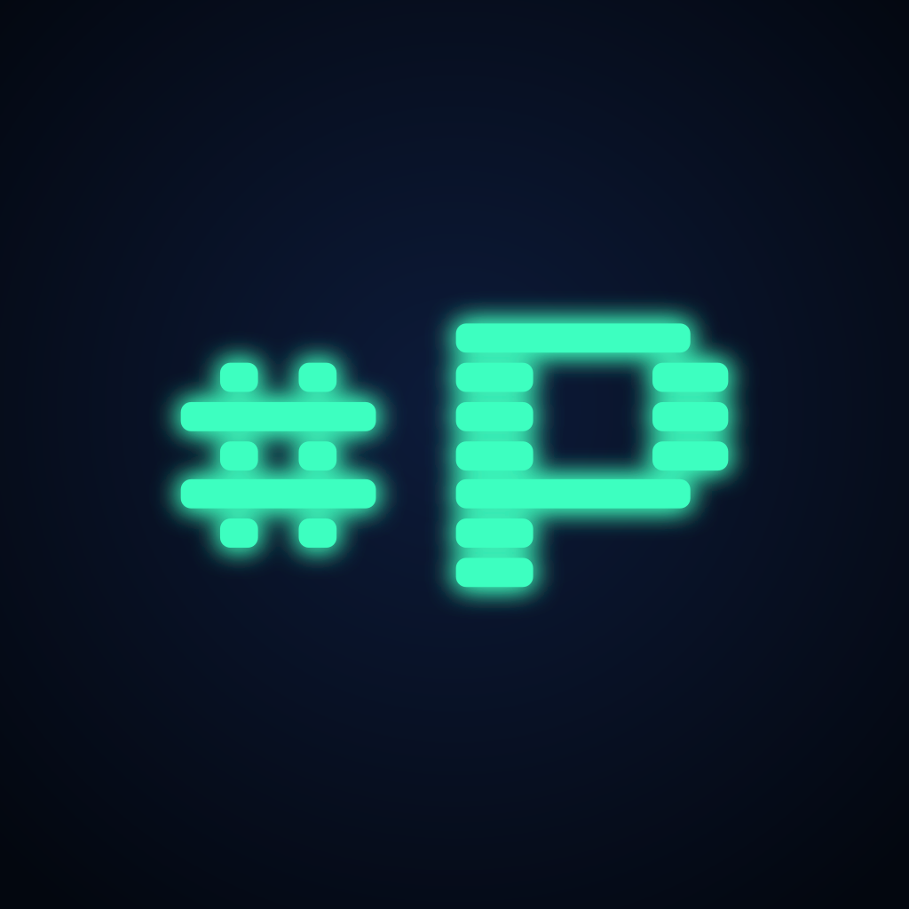

  

<h1 align="center">Pulina</h1>

  The chat app for <a href="https://www.pulina.fi">#pulina</a> and Finnish IRC. 
  A fork of <a href="https://github.com/rollecode/lobby">Lobby</a>, with Pulina's own look and setup on top.

## What Pulina is

Pulina is Lobby with a Pulina coat of paint. Everything Lobby does, Pulina does: full backlog, grouped chat, reactions and replies, highlights, the shelf, notifications on every platform. Lobby's [README](https://github.com/rollecode/lobby#readme) lists it all.

What Pulina changes:

- The name, the window and the folder it keeps its settings in, so Pulina and Lobby can live side by side.
- Pulina's icons, with the pulina.fi #P as the default.

## Staying in step with Lobby

Pulina's own changes sit on top of Lobby's `main`. Every night a workflow merges the newest Lobby into this fork. When the merge is clean it goes straight to `main`; when Pulina's changes and Lobby's touch the same lines, it opens a pull request instead.

Pulina's own files keep Pulina's version in every merge: this README and `ui/brand.js` and `ui/brand.css`, where the name, icons and colours live.

## Building

The same as Lobby: see [Development](https://github.com/rollecode/lobby#development) in Lobby's README.

## License

MIT, as Lobby.
